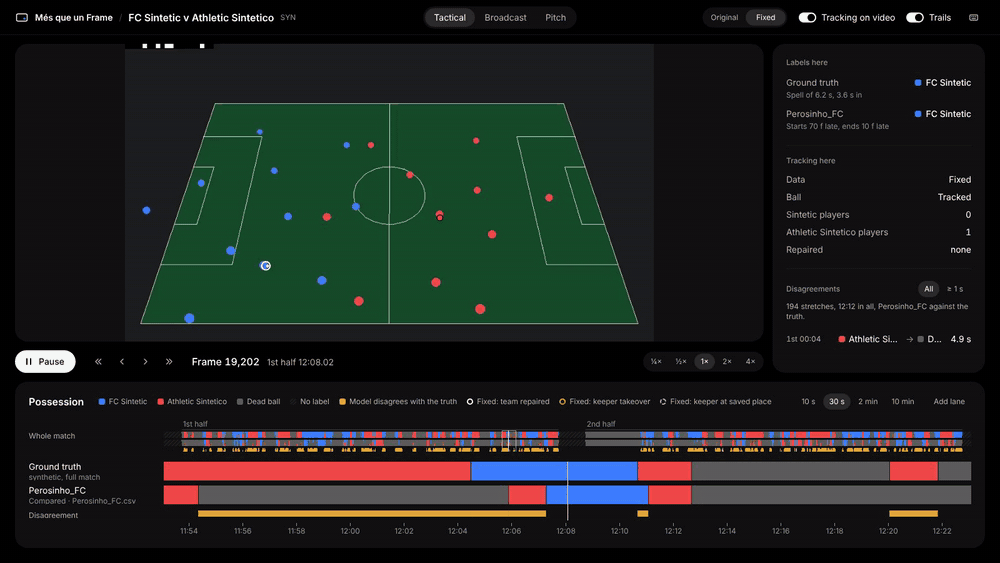
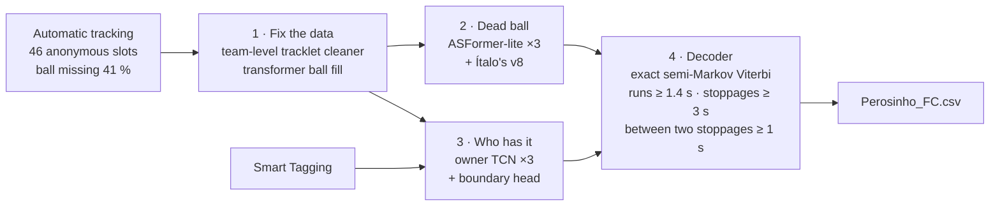

<div align="center">

# Més que un Frame

### *Robust possession spells from uncorrected tracking*

[More than a Hack 2027](https://github.com/metrica-sports/more-than-a-hack-2027), Phase 1 · FC Barcelona × Metrica Sports

**Team: Perosinho FC** · Carlos Magalhães, Ítalo Francisco, João Soares, João Monteiro, José Leites




<sub>Our viewer on the <b>synthetic</b> match (<code>python -m mqf.viewer.demo</code>): tracking drawn on the video, then the truth and the submission recipe's labels as lanes, with the stretches where they disagree.</sub>

</div>

---

For each of the **199,319 frames** of FC Barcelona vs Athletic Club (LaLiga 2024-25, MD2) we say who has the ball:
`H`, `A` or `D` (dead ball). The ranking metric scores **possessions as intervals**: every spell counts once, so
a missed 2-second possession costs as much as a missed minute. We therefore treat the task as segmentation:
learned per-frame evidence, then a decoder that outputs whole possessions.



Every stage was built and chosen on **other games only**: IDSSE, Metrica and PFF, under a simulated copy of this
match's tracking noise, scored with the official metric code. Nothing from Barça–Athletic was used to tune or to
choose.

**→ The full story is in the technical document, [Perosinho_FC.md](Perosinho_FC.md)**: how the data was fixed,
the dead-ball and possession models, the decoder, what worked and what didn't, training data, possession rules
and limitations. All 48 experiments are logged in [docs/EXPERIMENTS.md](docs/EXPERIMENTS.md).

## Reproduce the submission

You need Python 3.12–3.13, git, and the match bundle. The bundle is released to registered participants; it is not
in this repository and is never committed.

```powershell
python tasks.py venv ; .venv\Scripts\Activate.ps1   # Python 3.13 venv (uv if installed, else python -m venv)
python tasks.py setup                                # pinned deps + official repo (vendor/) + tests
python tasks.py install-torch --cuda cpu             # torch + requirements-model.txt (the CPU build is enough)
# unpack the bundle into data/  (data/tactical/..., data/broadcast/...)  or set MTAH_DATA_DIR
python tasks.py submit --team Perosinho_FC           # -> results/Perosinho_FC.csv, officially validated
python tasks.py reproduce --team Perosinho_FC        # regenerate into cache/reproduce/ + byte-compare
```

`make <target>` (Linux/macOS/WSL) is the same as `python tasks.py <target>`, and `python tasks.py help` lists
every target. The recipe is `FINAL` in `mqf/make_submission.py`. The torch models run on the CPU in float64 with
rounded outputs, so the same data and code give the same file on any machine.

We score with a **pinned** clone of the official repo in `vendor/mtah2027` (`python bootstrap.py`;
`--check-updates` lists newer organiser commits). `challenge/` keeps the organisers' files as they were when we
forked.

## Try it without the match data

```powershell
python -m pytest -q                                  # every test: synthetic matches, official scorer, decoders vs brute force
python -m mqf.viewer.demo ; python -m mqf.viewer --synthetic      # the viewer above (needs ffmpeg)
python -m mqf.make_submission --synthetic --final    # the whole submission recipe on the synthetic match
python tasks.py bundles                              # IDSSE / Metrica / PFF / SkillCorner -> tactical-format bundles
python tasks.py final-harness                        # the models on the 11 validation games x 6 noise columns
python tasks.py fusion-export ; python tasks.py fusion   # the decoder comparison (EXPERIMENTS #47-#48)
python -m mqf.viewer --val list                      # validation games in the viewer, with their full truth
```

## What's where

```
Perosinho_FC.md     the technical document (submitted with the CSV)
mqf/                the pipeline package
  make_submission.py  CLI; FINAL = the submitted recipe, FINAL_HMM = same models with the HMM decoder
  tracks.py           team-level tracklet cleaner          ball/      missing-ball imputation
  alive/  deadball/   dead-ball models (ASFormer-lite, v8)  owner/     who-has-the-ball models (owner TCN)
  fusion.py           decoders (stoppage = submitted) + the decoder suite
  harness/  external/ ATD noise model; other games -> tactical-format bundles
  viewer/             the match viewer
tests/              pytest
experiments/        one-off lab scripts
models/             the submitted models (README inside);  models/old/  everything else we trained, by family
harness_results/    every score we decided on, by pipeline stage (README inside)
docs/               EXPERIMENTS, TECHNICAL, CONTEXT, ...      challenge/   the organisers' files as forked
```

On Barça–Athletic the viewer's truth lane is the public 5 minutes: use it to check that things run, never to
tune. Keep screenshots of the real match out of AI chats and out of this repository.

## Credits

Team Perosinho FC: Carlos Magalhães, Ítalo Francisco, João Soares, João Monteiro, José Leites.

External data: IDSSE (Bassek, Weber, Rein & Memmert 2025, *Scientific Data* 12:195, CC-BY 4.0), the Metrica
Sports sample data, PFF FC World Cup 2022 tracking (raw files not redistributed), and SkillCorner open data (MIT).

Code: MIT. The match data is licensed for the competition only and is never committed.
